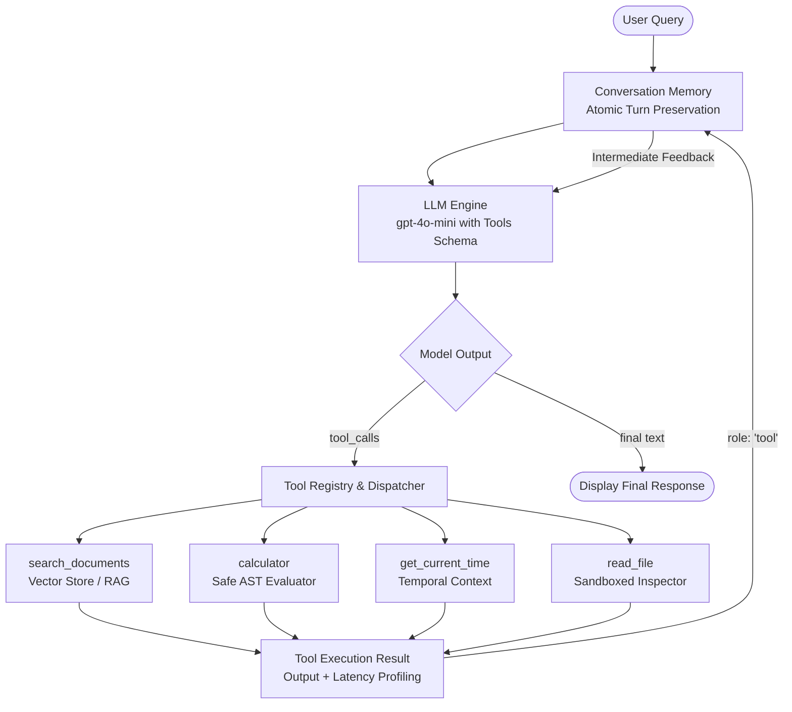

# ⚡ Retrieval Agent: Production Function-Calling & RAG AI System

[](https://www.python.org/)
[](https://platform.openai.com/docs/guides/function-calling)
[](#why-build-from-scratch)
[](#running-automated-tests)
[](#)

A complete, clean, production-grade Python AI Agent built from first principles for an **AI Engineering Internship Portfolio**.

Rather than relying on heavy wrapper frameworks (like LangChain or LlamaIndex), this project implements the agent loop, memory windowing, tool registry, and vector retrieval from scratch. It directly interacts with the native OpenAI Function Calling API to showcase a deep understanding of LLM orchestration, security guardrails, and production engineering practices.

---

## 🏛 Architecture Overview

The system operates on an iterative **Tool-Calling Loop** (Model $\rightarrow$ Tool Execution $\rightarrow$ Observation $\rightarrow$ Synthesis):



---

## 💡 Why Build From Scratch Instead of Using LangChain?

In top AI engineering teams, relying blindly on 50-layer abstraction libraries introduces hidden latency, obscure prompt bloat, and fragile debugging pipelines. Building this agent from scratch demonstrates:

1. **First-Principles Mastery:** Understanding the exact JSON Schema specifications and wire protocols expected by frontier models.
2. **Transparent Error Handling:** If a tool call fails or produces an error, the exception is caught, formatted, and fed back into the context window as a `role: "tool"` observation, enabling the model to self-correct.
3. **Deterministic Token & Latency Profiling:** Direct instrumentation of API calls, token counts, and tool execution times down to fractions of a millisecond.
4. **Interview Credibility:** Being able to explain every line of the agent loop, rather than saying *"LangChain handled that under the hood."*

---

## 🛠 Project Structure

```
retrieval-agent/
├── data/
│   └── knowledge_base.json      # Curated technical RAG documents & policies
├── tools/
│   ├── __init__.py              # ToolRegistry, schema exporter & execution dispatcher
│   ├── calculator.py            # Safe math evaluation using Abstract Syntax Trees (AST)
│   ├── rag_tool.py              # Vector store with cosine similarity & RAG retriever
│   └── other_tools.py           # Real-time clock & sandboxed filesystem reader
├── tests/
│   ├── test_tools.py            # Unit tests for security, math, RAG, and tools
│   └── test_agent.py            # Unit tests for memory windowing & agent loop
├── agent.py                     # Core RetrievalAgent loop & ConversationMemory
├── main.py                      # Interactive CLI chat interface powered by Rich
├── requirements.txt             # Minimal, production dependencies
├── .env.example                 # Template environment variables
├── .env                         # Local runtime configuration
└── README.md                    # Engineering documentation & interview guide
```

---

## 🔧 Core Tools & Design Decisions

### 1. `search_documents(query, top_k=3)`
* **Module:** [`tools/rag_tool.py`](file:///C:/Users/misba/.gemini/antigravity-ide/scratch/retrieval-agent/tools/rag_tool.py)
* **What it does:** Retrieves verified engineering architecture guides, RAG evaluation frameworks, and company policies from a vector knowledge base.
* **Dual Embedding Backend:**
  - **Online Mode:** Uses OpenAI's `text-embedding-3-small` for dense semantic representations when configured.
  - **Local/Fallback Mode:** Implements a zero-dependency TF-IDF and Cosine Similarity engine using pure `numpy`. This enables offline testing, mock evaluations, and instantaneous unit tests without burning API tokens.

### 2. `calculator(expression)`
* **Module:** [`tools/calculator.py`](file:///C:/Users/misba/.gemini/antigravity-ide/scratch/retrieval-agent/tools/calculator.py)
* **Security Guardrail:** Never calls Python's dangerous `eval()` or `exec()`.
* **Safe AST Parsing:** Parses the math expression into an Abstract Syntax Tree (`ast.parse(expr, mode='eval')`) and only executes nodes matching a strict whitelist:
  - Allowed operations: `+`, `-`, `*`, `/`, `//`, `%`, `**`
  - Allowed math functions: `sqrt`, `sin`, `cos`, `tan`, `log`, `log10`, `abs`, `round`, `floor`, `ceil`, `pow`
  - Constants: `pi`, `e`, `tau`
  - Guards against ReDoS/Denial of Service (caps exponential power operations to prevent CPU freezing).
  - Explicitly rejects code injection attacks (e.g. `__import__`, `open()`, `globals()`).

### 3. `get_current_time(timezone="UTC")`
* **Module:** [`tools/other_tools.py`](file:///C:/Users/misba/.gemini/antigravity-ide/scratch/retrieval-agent/tools/other_tools.py)
* **What it does:** Solves the notorious LLM limitation of lacking a real-time clock. Provides the agent with exact day-of-week, local time, and ISO-8601 timestamps for temporal reasoning and scheduling tasks.

### 4. `read_file(file_path, max_lines=50)`
* **Module:** [`tools/other_tools.py`](file:///C:/Users/misba/.gemini/antigravity-ide/scratch/retrieval-agent/tools/other_tools.py)
* **Security Guardrail:** Sandboxed to the project directory root. Employs `Path.resolve()` and `Path.relative_to(BASE_DIR)` to strictly forbid path traversal attacks (such as `../../etc/passwd` or `C:\Windows\System32`).

---

## 🧠 Memory Management: Atomic Turn Preservation

A common failure mode in junior AI agent implementations is naive message slicing:
```python
# ❌ NAIVE SLICING (BROKEN):
messages = messages[-10:]  # May sever an assistant tool_call from its tool response!
```
When an assistant message contains `tool_calls`, OpenAI's API strictly requires that **every** following message correspond to those `tool_call_id`s with `role: "tool"`. If an arbitrary slice cuts off the assistant call or one of the responses, the OpenAI API immediately throws a `400 Bad Request`.

**The Solution:**
[`agent.py`](file:///C:/Users/misba/.gemini/antigravity-ide/scratch/retrieval-agent/agent.py) defines a `ConversationTurn` dataclass:
```python
@dataclass
class ConversationTurn:
    user_message: Dict[str, Any]
    intermediate_messages: List[Dict[str, Any]]  # Tool calls + Tool responses
    assistant_message: Optional[Dict[str, Any]]   # Final synthesized response
```
The sliding-window buffer operates at the **Turn** boundary rather than the raw message index. This guarantees that tool calls and tool responses are kept together atomically.

---

## 🚀 Quickstart Guide

### 1. Prerequisites
- Python 3.11 or higher
- Git

### 2. Installation
Clone the repository and install the minimal dependencies:
```bash
git clone https://github.com/Misbah-84/retrieval-agent.git
cd retrieval-agent

python -m venv venv
# Windows:
.\venv\Scripts\activate
# macOS/Linux:
source venv/bin/activate

pip install -r requirements.txt
```

### 3. Configure Your API Key
Open `.env` (or copy from `.env.example`) and set your OpenAI API key:
```env
OPENAI_API_KEY=sk-proj-xxxxxxxxxxxxxxxxxxxx
OPENAI_MODEL=gpt-4o-mini
MAX_MEMORY_TURNS=5
MAX_AGENT_ITERATIONS=8
```

*(Note: Even without an API key, the agent runs in **Mock/Offline Mode** so you can test the CLI and tool execution immediately!)*

### 4. Run the Agent
```bash
python main.py
```

Options:
- `--model <name>`: Override the model (e.g. `gpt-4o` or `gpt-4o-mini`).
- `--mock`: Force offline demonstration mode without invoking OpenAI API.
- `--turns <int>`: Set the conversation memory window (default: 5).
- `--openai-embeddings`: Use OpenAI `text-embedding-3-small` for RAG instead of local TF-IDF.

---

## 💻 CLI Interface & Commands

The CLI uses [Rich](https://github.com/Textualize/rich) to display a clean terminal experience:

| Command | Action |
| :--- | :--- |
| `/help` | Displays interactive command reference |
| `/tools` | Prints all registered tools and their declared JSON Schema parameters |
| `/memory` | Inspects stored turns, context window length, and message diagnostics |
| `/clear` | Resets conversation memory to begin a fresh session |
| `/exit`, `/quit` | Cleanly terminates the agent CLI |

### Sample Prompts to Try:
1. **RAG Retrieval:**
   > *"What is our company's remote work equipment stipend and core collaboration hours?"*
2. **Safe Math:**
   > *"If an engineer spends 60% of their $1,500 equipment stipend on a 4K monitor and the rest on a chair, how much is spent on the chair? Calculate: 1500 * (1 - 0.60)."*
3. **Temporal Awareness:**
   > *"What day of the week is it today in America/New_York, and how many hours remain until 3:00 PM?"*
4. **Combined Multi-Tool Reasoning:**
   > *"Search our docs for the recommended chunk size for RAG, and then calculate what 20% overlap would be for a 512 token chunk."*

---

## 🧪 Running Automated Tests

Run the full automated test suite (16 tests verifying math safety, vector search, tool execution, and memory atomicity):

```bash
python -m unittest discover -s tests -v
```

Output:
```text
test_memory_clear (test_agent.TestConversationMemory) ... ok
test_memory_sliding_window_preserves_atomic_turns (test_agent.TestConversationMemory) ... ok
test_agent_math_tool_execution (test_agent.TestRetrievalAgentMock) ... ok
test_agent_rag_search_execution (test_agent.TestRetrievalAgentMock) ... ok
test_basic_arithmetic (test_tools.TestCalculator) ... ok
test_calculator_tool_wrapper (test_tools.TestCalculator) ... ok
test_division_by_zero_protection (test_tools.TestCalculator) ... ok
test_security_rejection_of_arbitrary_code (test_tools.TestCalculator) ... ok
test_get_current_time (test_tools.TestOtherTools) ... ok
test_read_file_security_sandbox (test_tools.TestOtherTools) ... ok
test_search_documents_tool (test_tools.TestRAGRetriever) ... ok
test_vector_store_retrieval (test_tools.TestRAGRetriever) ... ok
test_registry_dispatch (test_tools.TestToolRegistry) ... ok

Ran 16 tests in 0.012s
OK
```

---

## 🎓 What a Junior AI Engineer Learns From This Project

If you are preparing for AI Engineering or LLM Application Developer interviews, this project provides direct talking points for common technical questions:

### 1. How does Function Calling actually work?
* **Misconception:** The model executes the Python function itself.
* **Reality:** The model merely predicts a structured JSON payload conforming to your schema (`tool_calls`). The client application intercepts this payload, executes the local Python code, packages the result into a message with `role: "tool"`, and sends it back to the model for final synthesis.

### 2. How do you handle infinite loops in autonomous agents?
* If a model repeatedly calls tools without reaching a stopping condition, it can exhaust API budgets.
* **Defense:** An explicit `max_iterations` counter (set to 8 in [`agent.py`](file:///C:/Users/misba/.gemini/antigravity-ide/scratch/retrieval-agent/agent.py)). When exceeded, the agent halts, terminates gracefully, and logs a warning.

### 3. How do you prevent Prompt Injections & Code Injections in Tools?
* LLMs cannot be trusted to generate safe code. Passing model output to `eval()` is a critical security vulnerability.
* **Defense:** AST parsing with strict node validation and whitelisting ensures that even if a prompt injection attempts to run `__import__('os').system()`, the syntax tree validator rejects it before execution.

### 4. What is the RAG Triad for evaluation?
* Documented inside the built-in knowledge base:
  1. **Context Relevance:** Did the retriever pull only chunks pertinent to the question?
  2. **Groundedness / Faithfulness:** Is every claim in the answer strictly backed by the retrieved context?
  3. **Answer Relevance:** Does the answer directly address the user's intent?

---

## 📄 License
MIT License.Feel free to fork, customize, and extend!
